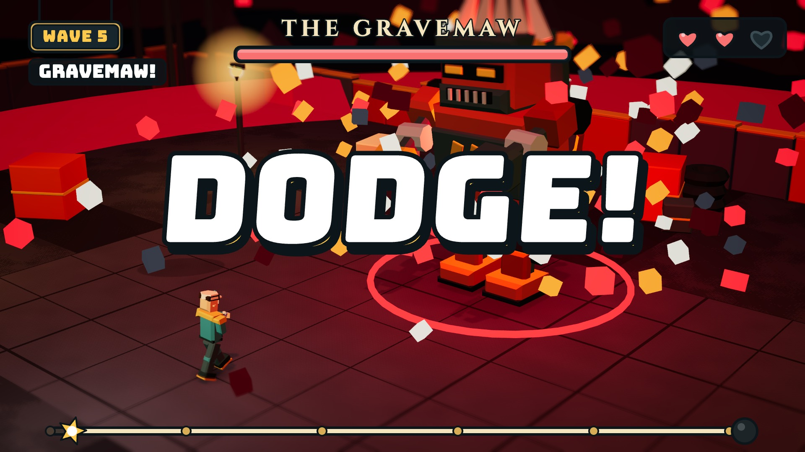

Arena Strike 3D - Beta 1.6.5

## Trailer

**Monster Rush** (30 s, 1080p): click the image to watch [trailer/monster-rush.mp4](trailer/monster-rush.mp4). Every shot is drawn in the game's own world, with its models, poses, recoil and death motion. The sound effects come from the game's own synthesizer, and the gunfire is timed to real gameplay footage.

Open index.html in a browser (a local server such as `python3 -m http.server` is the safest way; double-clicking also works in most browsers).

index.html        page shell, icon sprite, CDN libraries (Three.js r128, Howler.js 2.2.4, PeerJS 1.5.4)
css/style.css     all styling
js/01..11-*.js    game code in load order (core, render+audio, world, models, player/input, modes, actions/HUD, parkour/radar, party/online, UI pages + cinematics, main loop)

The scripts are classic scripts sharing one global scope, so keep the load order in index.html.

Reward codes and developer access
- Open Redeem codes from the lobby. `DEV` grants the exclusive Dev gun skin and Dev outfit. Equip them in Loadout; neither item drops from cases or is sold in the Shop.
- Reward codes ignore letter case and surrounding spaces. Each code can be claimed once per browser save; inventory and redemption history persist with the existing local save.
- Add or remove codes in `REDEEM_CODES` at the very top of `js/01-core.js`. Copy an entry for coins, items, or both, then commit. Commented examples are included. See [SETUP-CODES.md](SETUP-CODES.md) for copy-and-paste examples.
- Codes use 1–64 letters, numbers, hyphens or underscores, starting with a letter or number. The browser hashes the entered code and stores only the hash for new claims. Existing claims from the previous version still prevent duplicate rewards.
- The game reads the code list directly; `js/reward-codes.js` and `GAME_CODES` are no longer used. The Deploy game workflow publishes static files without a secret or build dependency. Reward checks require HTTPS or localhost to preserve hashed claim history.
- Custom mode requires the separate, case-sensitive developer code on the Redeem codes page. Unlock it to open Battle Simulator or Sandbox, or return to Monster Rush and switch Custom mode On. Access lasts until page reload or Lock access; old saved Grind settings no longer enable it automatically. Online co-op cannot use Custom mode.
- The shipped password is a SHA-256 digest in `DevAccess`. To change it, hash a new game-only password with SHA-256 and replace `passwordHash`. Password checks require HTTPS or localhost. This is a client-side convenience lock, not secure authorization; a server would be needed to enforce developer privileges against modified clients.
- Run regression checks with `node --test tests/rewards.test.cjs tests/build-pages.test.cjs` (Node 24). Set `ARENA_TEST_DEV_PASSWORD` to the configured game-only password to also run the successful-unlock checks without publishing that password in the test file.
- Reward codes are public in the game's source, and saves are local to each browser. Custom mode keeps its separate password. Secure account-based rewards would require a server.

Custom battles and previews
- Battle Simulator has seven preset enemy armies, budgets, and nine troop types. Place your troops on the blue side, start the battle, and advance after winning. Edit / reset restores your formation and budget.
- Sandbox has an open center, connected raised terraces, free flight, two placement teams, a nine-slot hotbar, sample armies, pause/speed controls, and up to 60 living units. Start a battle and use Join Blue / Join Red to fight; F returns to flight. Edit / reset restores the formation from the start of the battle.
- Both custom modes have three original low-poly landscapes: Meadow Railway, Canyon Express, and Frostfall Valley. Choose a landscape before starting; campaign challenges also cycle through them. Terrain height is shared by placement, troops, player movement, and weapon collision.
- The scenery includes an elevated circulating train with freight cars and smoke, railway bridges, a station, a spinning windmill, waving pennants, and flowing water. Trains are decorative and stay outside the playable area. Scenery animation respects the system's reduced-motion preference.
- Troops have distinct armor, weapons and silhouettes. The editor includes illustrated troop cards, a translucent placement preview with attack range, a live minimap, army counts, budget indicators, battle results, and a Hide tools button for a clearer view. Use the mouse wheel to change flight height.
- Flight controls: WASD to move, Space up, C or Ctrl down, Shift faster, right-drag to look, Q/E or arrow keys to turn, mouse wheel for altitude, 1–9 to choose units. Click the ground to place; the Remove tool refunds campaign units. These modes currently use mouse and keyboard.
- Custom battles do not grant coins, XP, or quest progress. Existing game saves are preserved.
- Loadout has live previews for finishers, emotes, equipment, profile items, and music, including locked items without unlocking them.

New in Beta 1.6 (and Beta 1.5)
- Battle Pass: 150 tiers in six chapters (hero header, next-exclusive card, chapter tabs, Claim all, Skip tier); tiers 1-30 unchanged
- Quests: Daily, Weekly (6 goals, reset every Monday) and Season (12 long-term goals) with Battle Pass XP and coin rewards (WQ/SQ in js/01-core.js)
- Shop: Items tab with rarity pricing, ~19 new cases, 16 more finishers, many more backgrounds and items; coin totals are synced everywhere (paintCoins in js/10-ui-pages.js)
- Liquid glass revamp: full-width segmented controls with a sliding thumb (Glide in js/10-ui-pages.js), centred strips, content-height sidebars
- Graphics: sun glare, lens ghosts and a colour grade on High (Flare in js/11-main-loop.js)
- Per-gun scopes: iron sights, red dot, holographic, 3x optic, ghost ring, rail, scout, marksman, long-range and beam scopes (right mouse to aim; scoped guns have a real zoom lens you look through, on the gun itself)
- Revamped Shop with Cases and Finishers tabs; Kill finishers have their own section (18 finishers, a Finisher Case, and a Finishers tab in Loadout)
- New pause menu: Resume, Map and Restart run buttons, grouped settings with live values, and a Leave button that asks twice
- Menu polish: quicker, calmer animations, matching sliders, scrollbars and button states, a lobby Play panel that always fits
- Elimination screen no longer darkens the picture
- Rarity scaling: Legendary and Secret guns are much stronger than Common ones
- Strengths and weaknesses sheet for every gun and knife
- Monster wave modifiers, elites, ground-emerge effects, telegraphed monster attacks
- Corrupted wave visuals, new shooting effects
- Arcade sounds, music discs (Music Case) for home and match music, boss and corrupted themes
- Phone and tablet touch controls in landscape (only on touch devices)
  To try the touch layout on a computer, add ?touch=1 to the address.
- Death screen with slow-motion kill-cam in every mode (js/06b-death.js)
- Walkable roofs: every house has an outside staircase; pitched roofs use stepped collision bands up to the ridge, flat roofs are decks
- Line-of-sight checks on every monster, boss and bot attack; monsters and bosses collide with the world
- Nav flow field for monsters (js/06d-nav.js) and wave phases Whiteout, Blight and Firestorm (js/06e-phases.js); boss hits are capped at about a third of max health
- Boss health, damage, speed, attack tempo and per-hit cap scale with difficulty (BD table in js/06-game-modes.js)
- Reload plays as a staged sequence (mag out, fresh mag in, seat, rack); optics are open sights
- Aether Rifle ADS: gun drops 0.05 while aiming (js/05-player-input.js, VM.frame) and sight fov is 54; SV.aether (js/05b-scopes.js) keeps the centre clear and puts the ornament (gradient ring, ticks, diamond nodes) at the rim
- Third person (Parkour, V): chase camera orbits behind your aim; optic guns hide 3D sights while aiming so nothing sits over the reticle (js/04-models.js buildGun)
- Developer Custom mode (Monster Rush lobby toggle, S.opt.grind -> global grind): monster hp x.2, speed x.7, all damage to you x.12, boss table BDG in js/06-game-modes.js
- Parkour maps (js/08-parkour-radar.js build): per-map style MSS (ledge/circuit/spire/stones/stairs); path styles walk platforms along a curve (circle, square, zig, wave); S.pkLay clears old times/ghosts when layouts change
- Monster Rush stages: stageChange() in js/06-game-modes.js runs from nextWave() after each boss wave (wave%5===0): veil #stagefx, corrReset, clearEnts, buildWorld(STAGES[n]), new spawn point; skipped in online co-op
- Ghost level for Monster Rush with hovering ghosts, a Ghost boss that vanishes and reappears in sight, and a Corrupted boss blink (js/06c-ghost.js)
- Smoother monster stair/crate climbing, fixed bullets being absorbed by spawning monsters, corpses sink through the right floor
- Online rooms reconnect to the broker instead of expiring, stay open until you leave, and the party survives going back to the lobby; the host can swap teams and kick
- Auto graphics picks its starting level from GPU model, CPU cores, memory, screen size and device type (HW in js/01-core.js) and remembers a step-down
- Low and Potato use baked ground shadows, blob shadows under characters and the same sky and fog, so they look like High without the shadow map
- All levels: sun-scatter fog, low ground haze and baked contact shading around walls and crates (js/03-world.js)
- Windows and Linux: raw mouse input (no desktop acceleration), font fallbacks, WebGL context-restore handling; works in Chrome, Edge and Firefox
- Battle Pass: 150 tiers; matches, kills, waves and bosses all pay (first 3 matches a day x1.5), quests are a bonus; coins after Tier 150 (BP_XP / bpDaily in js/01-core.js)
- Quests: 90-task pool, daily rotation of untouched quests, 3 free Switches a day, Skip for coins; quests also show on the pause screen (qSwap / qSkip in js/01-core.js, pauseQuests in js/10-ui-pages.js)
- Map: press M (MAP button on phones) for a north-up map of the current mode with players, bots, monsters and bosses (BigMap in js/08-parkour-radar.js)
- Monster Rush boss leaps are capped at 13 meters (LEAP_MAX in js/06-game-modes.js)
- Roofs: pitched (stepped walkable collision, chimneys) and flat decks, each with a staircase, on a road-driven map layout (house/RDP in js/03-world.js); tower canopies and beacons, parkour arches
- Radar sweep pings, new end/death/pause screens, 26 music discs (songMix/SGS in js/02-render-audio.js, MU in js/01-core.js)
- Hitbox tuning (HURT boxes in js/04-models.js), shotgun spread, knife capsule, wheel-switch debounce
- Motion polish: landing/sprint viewmodel motion, third-person air pose, HUD bumps and health trail, High-tier Bloom (js/11-main-loop.js)

Libraries and credits
- Three.js (MIT) - 3D rendering
- Howler.js (MIT, goldfire/howler.js) - audio playback; every sound is synthesised in code, rendered once, then played through Howler
- PeerJS (MIT) - online/party play
- game-icons.net (CC BY 3.0, by Lorc, Delapouite and contributors) - item emblems and menu icons, inlined as SVG
- Phosphor Icons (MIT, phosphoricons.com) - plain arrow and copy glyphs, inlined as SVG
If the Howler CDN is blocked the game falls back to its built-in synth, so it still has sound.
- Parkour specials (js/08-parkour-radar.js mk/slab/dynFrame): mv sliding platforms, cr crumbling slabs, bo launch pads (aim the jump at the next ledge), va vault walls; per-difficulty chances in SPD, per-map multipliers in MSS.sp; scenery ring built after bnd; S.pkLay=3
- Monster Rush arenas (js/03-world.js arenaPack, opt.waves): four layouts picked by seed (fortress, crossing, colosseum, lanes), built before scatter props
